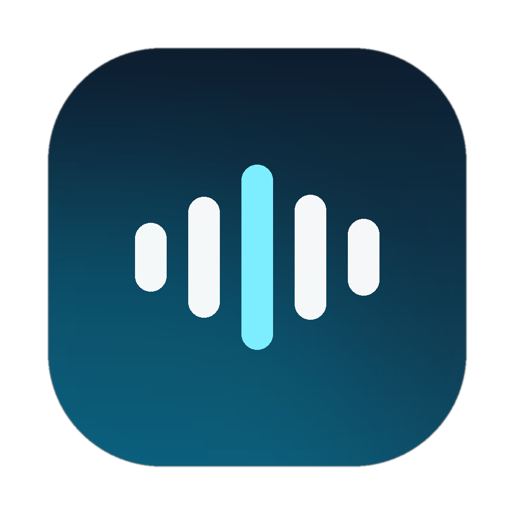
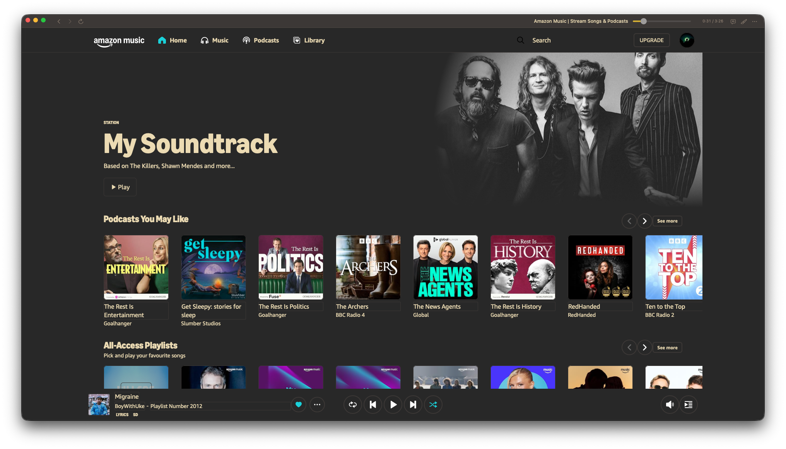

<h1 align="center">
  
  <br />Zonic
</h1>
<h3 align="center">A tiny native macOS client for Amazon Music</h3>
<div align="center">
  
  
  
  
  
</div>

> [!NOTE]
> This project was built with [Gorkie](https://github.com/techwithanirudh/gorkie), and OpenCode, both of which are an AI assistant.
> The code, the releases and this README were written by AI, with [Jacob](https://github.com/SmartSparkCoding)
> directing, testing and deciding what ships. Every build is built and published by GitHub Actions from
> the source in this repo, so you can read exactly what you are running.

> [!CAUTION]
> This is not affiliated with, endorsed by, or supported by Amazon. "Amazon Music" is their trademark,
> used here only to say what this app plays. It is an unofficial wrapper around the web player you
> already pay for, and Amazon can change their site at any time and break it.



Zonic runs Amazon Music's own web player inside a native WebKit window, then adds the things a browser
tab does not do well: a real app in the dock, working media keys, Control Center, a titlebar worth
looking at, themes that reach the page, a lyrics screen, and updates that install themselves. About
1 MB of binary, no Electron, no background daemons, no second browser.

Named the way [Slick](https://github.com/3kh0/slick) is named after Slack. Zonic, from Amazon and sonic.

## Features

- **Native window, no browser chrome**: a 34pt titlebar with back, forward and reload on the left, what
  is playing in the middle, the scrubber and theme controls on the right.
- **Media keys and Control Center**: play, pause, next and previous from the keyboard, and one honest
  entry in Control Center rather than two.
- **Space to play or pause**, unless you are typing in a search field.
- **Seek inside a track**: the titlebar scrubber, or shift cmd left / right for ten seconds. Seeking
  drives Amazon's own progress bar, because their DRM stream clamps `currentTime` jumps.
- **Skips that always land**: Amazon caps skips per account per hour on their servers, so when a skip
  is refused Zonic runs the current track to its end and lets the queue advance instead.
- **Lyrics**: a full-window screen with the artwork as a blurred backdrop, synced lines lit in your
  theme's accent, and click-a-line to seek. Words come from [LRCLIB](https://lrclib.net).
- **Twelve themes**: Match System, Light, Dark, Gruvbox Dark, Nord, Catppuccin Mocha, Tokyo Night,
  Dracula, One Dark, Solarized Dark, AMOLED Black and Rose Pine. Window, chrome, settings and the page
  itself all take the palette.
- **Last.fm scrobbling**: your own API key, connect in the browser, now-playing pings and scrobbles at
  half the track. cmd L loves the current song.
- **Updates that install themselves**: Zonic checks the release feed, verifies the download against the
  release checksums, swaps the bundle and reopens. A new version says what changed the first time it runs.
- **Zoom, full screen, external links in your browser**, and no telemetry of any kind.

## Installation

Zonic is macOS only, on Apple silicon or Intel, macOS 12 or newer. Grab the `.dmg` from the
[latest release](https://github.com/SmartSparkCoding/zonic/releases/latest).

1. Open the dmg and drag **Zonic** into Applications.
2. The build is signed ad-hoc rather than with an Apple Developer certificate, so Gatekeeper will
   complain the first time. Right click the app, choose **Open**, then **Open** again, or run:

   ```bash
   xattr -dr com.apple.quarantine /Applications/Zonic.app
   ```

3. Sign in with your Amazon account once. The session is kept in the app's own cookie and page storage,
   so you stay signed in across restarts.

### Build from source

Needs the Xcode command line tools (`xcode-select --install`).

```bash
git clone https://github.com/SmartSparkCoding/zonic
cd zonic
./scripts/build-app.sh        # build/Zonic.app, then dist/*.dmg and .zip
VERSION=1.0.0 ./scripts/build-app.sh
```

The workflow in `.github/workflows/build.yml` compiles the universal binary on a macOS runner and
publishes a release on every push to `init`, with the version taken from the run number.

## Updates

Zonic checks the GitHub release feed a few seconds after launch and offers anything newer, and
**Zonic > Check for Updates…** does it on demand. The update downloads the zip, verifies it against the
release `SHA256SUMS.txt`, hands the bundle swap to a short shell script that waits for the app to quit,
reopens it, and clears the quarantine flag so you do not get the Gatekeeper dance twice. To do it by
hand, quit Zonic, drag the new `Zonic.app` over the old one, reopen.

## Themes

Pick a theme in **Zonic > Settings…** (cmd comma), from the theme button in the titlebar, or from
**View > Theme**. The palette drives the titlebar, the settings window and the lyrics screen. It can
also repaint the Amazon Music page itself, which Amazon's markup makes best-effort work: **Tint** recolours
text, surfaces, controls and scrollbars, **Invert** darkens the whole page and tints it, and **Off**
leaves the page alone. There is also a crossfade length for the gap between tracks, since a real
overlapping crossfade is impossible inside one DRM-protected player.

## Lyrics

**Playback > Lyrics**, or cmd shift L, or the speech bubble in the titlebar. Synced lines follow the
song, the current line takes the accent colour, any line can be clicked to jump there, and Esc closes.
Unsynced lyrics are shown as plain text and say so.

## Scrobbling

Create an API application at [last.fm/api/account/create](https://www.last.fm/api/account/create), paste
the key and secret into Settings, then **Connect** and approve Zonic in the browser. Zonic pings
now-playing on every track change and scrobbles at the halfway point. **Send Test Scrobble** shows
Last.fm's exact answer if something does not appear on your profile. Keys live in the app's preferences
rather than the keychain.

## Keyboard shortcuts

| Action | Shortcut |
| --- | --- |
| Play / pause | space, or cmd P |
| Next / previous track | cmd right / cmd left |
| Skip forward / back 10s | shift cmd right / shift cmd left |
| Lyrics | shift cmd L |
| Love on Last.fm | cmd L |
| Reload | cmd R |
| Back / forward | cmd [ / cmd ] |
| Zoom in / out / reset | cmd = / cmd - / cmd 0 |
| Settings | cmd , |
| Full screen | ctrl cmd F |

## How it works

- `Sources/Zonic/WebController.swift` owns the `WKWebView` pointed at `music.amazon.com`, with a
  persistent data store, a Safari user agent and an injected theme stylesheet.
- `Sources/Zonic/Bridge.swift` is the injected JavaScript. It reads `navigator.mediaSession.metadata`
  and the audio element, reports state four times a second, and exposes `window.__zonic` with
  `command`, `seekTo`, `seekBy`, `tick` and `debug`. Fading across a track boundary happens here.
- `Sources/Zonic/SessionVault.swift` keeps the Amazon cookies and page storage on disk so a restart does
  not sign you out.
- `Sources/Zonic/Updater.swift` talks to the GitHub releases API, verifies the checksum and lets a shell
  script do the swap once the app has quit.
- `Sources/Zonic/Theme.swift` holds the palettes and the page skin. `LyricsView.swift` and `Lyrics.swift`
  are the lyrics screen and the LRCLIB client. `Scrobbler.swift` signs and sends the Last.fm calls.

It does not patch Amazon's bundle: the page is theirs, unmodified, and everything Zonic adds happens
around it or through the same media session your browser uses.

## Known limitations

- Amazon caps skips per hour on their servers, per account and plan. Nothing client side can lift that.
- Seeking is refused on some content, because their DRM stream decides what the player is allowed to
  jump to.
- Amazon can change their DOM whenever they like. Next and previous are found by matching `aria-label`,
  `title` and `data-testid` with a looser fallback, so if they stop responding, that matching in
  `Bridge.swift` is the place to look.
- The page skin is a tint over markup Amazon owns, so it can look patchy on pages they redesign.
- The app is not notarised, hence the right click on first launch.
- No offline downloads: Amazon does not expose them to the web player.

## Credits

- [Slick](https://github.com/3kh0/slick) by [@3kh0](https://github.com/3kh0) for the naming convention,
  the unmistakable shape of a good mac client mod, and the README this one is modelled on.
- [Apple Music](https://www.apple.com/apple-music/) for the lyrics screen worth copying, and
  [LRCLIB](https://lrclib.net) for the words.
- [Last.fm](https://www.last.fm/) for an API that still just works.
- Everyone who installed a 0.x build, hit a bug and said so.
- Gorkie and OpenCOde for writing the code, and [Jacob](https://jacob.navaratne.uk/) for flying it.

## Legal

### Licensing

MIT. See the [LICENSE](LICENSE) file. The code is here for free, use it at your own risk.

### Privacy

Zonic talks to three places: Amazon Music, GitHub for updates, and Last.fm if you connect it. There is
no analytics, no crash reporting and no telemetry of any kind, and nothing is sent to the person who
wrote it. Your Amazon cookies and page storage sit in `~/Library/Application Support/Zonic/`, readable
only by your user. Last.fm keys are stored in the app's preferences, which are not encrypted, so treat
them like any other local credential. Lyrics lookups send the artist, title, album and duration of the
track to LRCLIB.

### Trademarks

Amazon, Amazon Music and the Amazon Music logo are trademarks of Amazon.com, Inc. or its affiliates.
This project is unofficial and unaffiliated. It does not include, host or redistribute any Amazon
software or content; it is a browser window pointed at a service you have an account with. If Amazon
asks for it to stop, it will.
